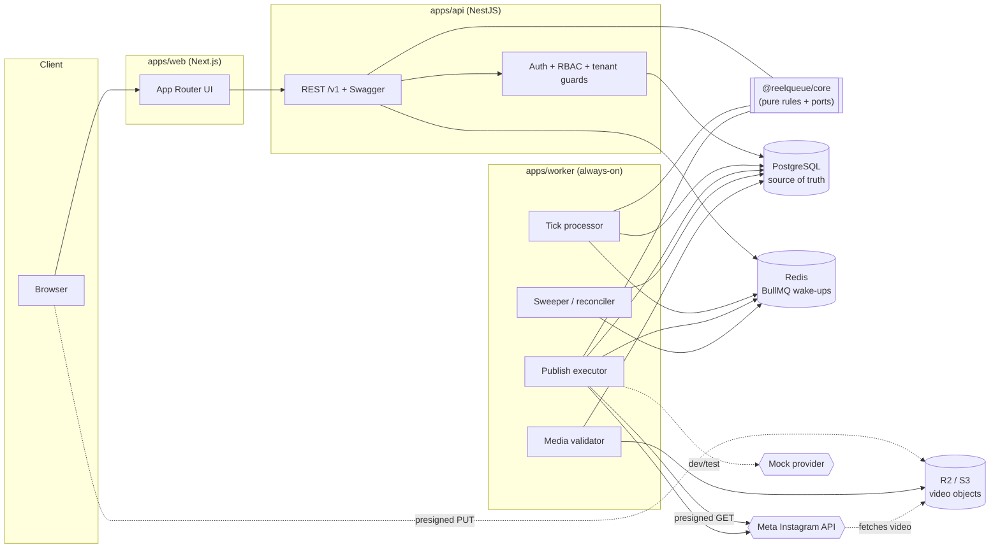
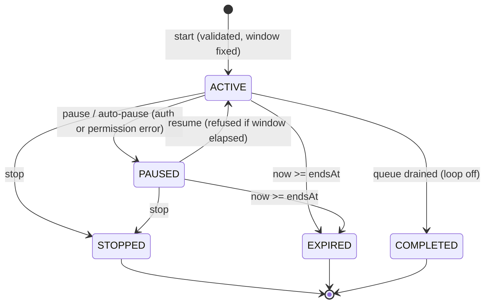
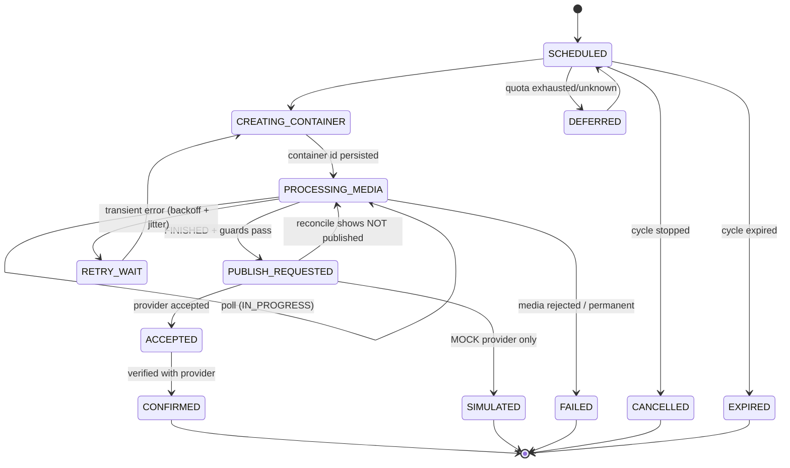
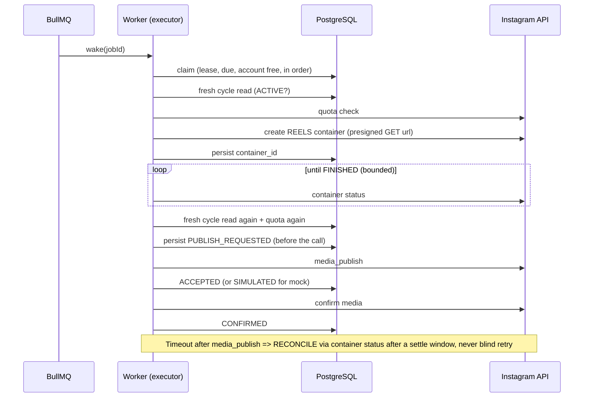

# Architecture

## System

* **PostgreSQL decides, Redis nudges.** A BullMQ job only says "look at job/cycle _X_ at time _T_". The worker re-reads
  PostgreSQL, takes a lease, and acts. The **sweeper** re-enqueues due unleased jobs, so a Redis flush delays work but
  never loses or duplicates it.
* **Only `@reelqueue/core` knows the rules.** API and worker adapt it; no scheduling logic lives in controllers or processors.

## Cycle lifecycle

`effectiveStatus()` treats an ACTIVE/PAUSED cycle past `endsAt` as EXPIRED even if the expiry job is late, and every
irreversible step uses it.

## Publish job lifecycle (executor)

No edge leaves `PUBLISH_REQUESTED` toward `CANCELLED`/`EXPIRED`: once a publish may have been sent, the outcome is
reconciled first.

## One publish, step by step

## Semantics (precise)

| Topic | Decision |
|---|---|
| Interval | Measured **between batch starts**. `next = max(prevScheduled + interval, now)`; missed slots are not replayed; a batch is held while the previous one has unresolved jobs. Default 20 min, bounds 5–1440 (app limits, not Instagram's). |
| Batch size | 1–50 (app limit), additionally capped by the **live Instagram quota**; the remainder stays queued and is scheduled later, with the reason shown in the UI. |
| Cycle | `endsAt = startedAt + duration` (default 24 h). Pause does not extend it. Publications start only before `endsAt`. |
| Loop | When the queue drains and looping is on and the cycle is active, the cursor wraps to position 1 and `iteration` increments (new idempotency key per pass). |
| Stop | Takes effect before the next irreversible step. Unstarted jobs → `CANCELLED`. A request Instagram already accepted **cannot be recalled**, and previously published Reels are **not** removed. |
| Expiry | Unstarted jobs → `EXPIRED`; requested/accepted jobs are reconciled to a final state. |
| Retries | Transient/timeout: bounded exponential backoff + jitter, honouring `Retry-After`. Permanent (validation, permission, media rejected): no retry. Quota: defer. Auth/permission: pause the cycle and flag the account. |
| Guarantee | Safe **at-least-once execution** with duplicate prevention and reconciliation. **Not** exactly-once: if a publish response is lost and Meta has not yet reflected it when the settle window ends, a duplicate is theoretically possible (see risk R2). |
