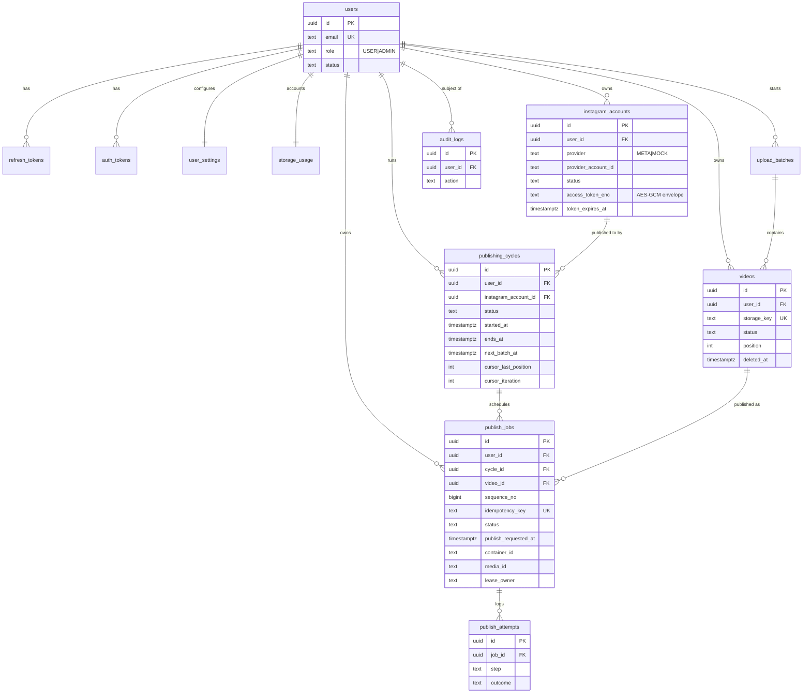

# Database

PostgreSQL 14+ (verified on 16.15). Schema source: `apps/api/migrations-sql/0001_init.sql`.
TypeORM migrations wrap these SQL files (`synchronize` is **never** enabled).

## ER diagram



## Key relationships and why

* **Tenant integrity is enforced by the database.** Every child table carries `user_id` and references its parent via a
  composite key, e.g. `publish_jobs (video_id, user_id) → videos (id, user_id)`. A job of user B cannot reference a video,
  account or cycle of user A, even through an application bug.
* **Duplicate prevention:** `UNIQUE(idempotency_key)`, `UNIQUE(cycle_id, video_id, iteration)`,
  `UNIQUE(instagram_account_id, sequence_no)`.
* **One live cycle per Instagram account:** partial unique index on `publishing_cycles(instagram_account_id) WHERE status IN ('ACTIVE','PAUSED')`.
* **Videos in use cannot be removed:** `publish_jobs.video_id → videos` is `ON DELETE RESTRICT`; the API soft-deletes (`deleted_at`) and only hard-deletes objects with no job rows.
* **Honest status:** `CHECK` constraints forbid MOCK jobs from being `ACCEPTED/CONFIRMED` and META jobs from being `SIMULATED`.
* **Settings snapshot:** a cycle copies batch size / interval / loop at start; later edits never change a running cycle.
* **Cascade choices:** deleting a user cascades to their data (account-deletion workflow, after a grace period);
  `audit_logs.user_id` is `SET NULL` so history survives; `audit_logs` rows are immutable (trigger).
* **Indexes:** due jobs (`publish_jobs_due_idx`), account ordering, active/due/expiring cycles, per-user queues and history, token expiry, open upload batches.

## Verification (run on PostgreSQL 16.15)

```bash
# applies 0001_init.sql to a fresh database and runs 18 invariant checks
PGDATABASE=reelqueue_verify ./scripts/verify-db.sh
```

Checks: cross-tenant FK rejection (video, account, default account), duplicate key/slot/sequence, mock-never-confirmed,
mock ids, referenced-video delete blocked, single live cycle, config bounds, terminal-cycle `ended_at`, audit immutability,
reconnect after disconnect.

## Not covered by the schema (application-level)

Row-level security (optional hardening), state-transition legality (enforced in `@reelqueue/core` `assertTransition`),
`storage_usage` consistency (updated in the same transaction as video changes; nightly recalculation job planned).
